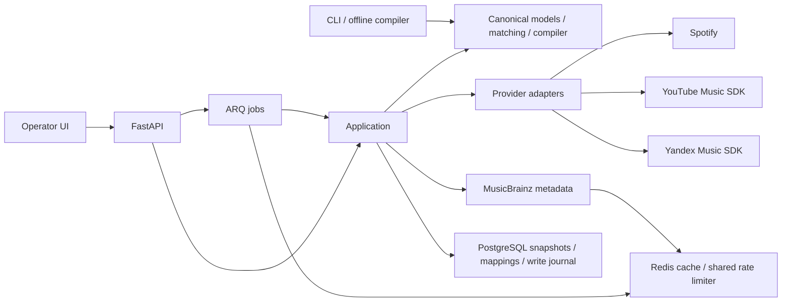

# Architecture

Harmonia treats a service catalogue as one view of music, never as its internal identity system. Version 0.1 uses one Python package and one deployable image, with separate API and worker processes. No Django models or ORM entities orchestrate external calls.

## Boundaries

- `domain/`: validated Pydantic value objects and deterministic pure algorithms. No HTTP, database, SDK, environment, API or job imports. Pydantic is a schema/validation dependency, not an application framework boundary.
- `application/`: transfer previews, confirmed mappings, occurrence-aware diffs and export orchestration. It receives provider/store objects rather than importing an adapter.
- `providers/`: the async `Provider` contract, capability declarations and three adapters. Spotify uses async httpx; Yandex uses ClientAsync; the blocking YouTube SDK is serialized through a lock and offloaded to a thread. Adapters convert metadata at their boundary. They do not fetch audio, make playlist policy decisions, or generate features.
- `infrastructure/`: SQLAlchemy persistence, HTTP retries, Redis cache/limiter, runtime configuration, MusicBrainz and ARQ jobs. MusicBrainz is a metadata layer rather than a playable streaming provider.
- `api/` and `cli.py`: presentation and input validation. API queues long operations. CLI compilation runs completely offline. The UI uses ordinary DOM APIs with `textContent` for catalogue data.

## Canonical model

An Artist is an identity/credit. A Recording is a performance/version independent of a release. A Release is an album/edition. A Track combines a recording with release context, explicit flag, genres, provider identifiers and optional user-supplied AudioFeatures. A Playlist is an ordered sequence of track occurrences, so imports preserve duplicates. ProviderTrack records provider identity, link and availability. IDs remain namespaced by provider unless explicitly reconciled; a MusicBrainz match does not silently overwrite another provider's identity.

A recording may carry multiple version tags, such as live + remaster. Version detection considers labelled descriptors after separators or within brackets; words in bare titles are preserved. Named edition details (remixer, venue, remaster year) are retained for review gates and duplicate identity instead of being erased with the generic version label. Incomplete or misleading catalogue metadata can still need manual review. The matcher never claims that metadata alone can prove audio identity.

Snapshots and features are stored as validated JSON aggregates in PostgreSQL. This supports lossless import/export and straightforward schema versioning without a premature music graph schema. Playlist keys, confirmed mappings and operation keys have database-enforced primary keys. A future large catalogue can add normalized recording/search tables via migrations without changing core algorithms. Snapshot schema version 1 rejects unknown fields instead of silently ignoring misspellings.

## Matching decisions

Every candidate first passes version compatibility, contradictory MusicBrainz ID, title/artist plausibility and known duration checks. Passing candidates receive identifier priority: exact ISRC, exact MusicBrainz recording ID, then weighted text/artist/duration/album evidence. Fuzzy matching uses the standard library with bounded input lengths. Scores sort deterministically by confidence and track ID. A gap below 0.025 between the leading candidates requires review; the default automatic threshold is 0.90. Alternative results are retained for explanation.

Search collects an exact-ISRC query when supported and a metadata query for alternatives. MusicBrainz can enrich the source recording only when its own conservative match is unambiguous. A missing MusicBrainz ISRC returns an empty negative-cached result. Ambiguous or unavailable MusicBrainz evidence produces a preview with explicit review reasons instead of silently confirming a match or aborting the entire preview. A persisted manual override short-circuits searches and is explicitly labelled. Confirmed mappings are per source track and destination provider; there is no global fuzzy cache that could spread one wrong match across unrelated users.

## Compilation

Filtering enforces known duration, explicit policy, versions and required features. A beam carries candidate sequences, with deterministic seeded hashes for equal-score ordering. A quarter of its slots retain shorter prefixes to avoid stranding every path with an unfillable duration gap. Each expansion checks artist counts, recent artist overlap and recording identity (shared ISRC, MusicBrainz ID, or normalized artist/title plus version). Its objective combines target-duration coverage and mean per-track/transition quality. Curves are anchored to elapsed requested duration, so a short partial sequence does not pretend to reach the end of a 90-minute energy curve. Two bounded swap passes refine order without weakening constraints.

The solver is a function accepting constraints and canonical candidates. A future OR-Tools implementation can implement that same function shape; no abstract solver factory is introduced before a second solver exists. The bounded heuristic can underfill or find a local optimum. Its result contains warnings, and the user sees the actual duration.

## Transactions, concurrency, failure handling

Import upserts a complete snapshot in a short transaction. Spotify imports check snapshot ID before and after pagination; YouTube/Yandex imports have no transactional remote snapshot guarantee. Plans are immutable PostgreSQL records generated by the worker; the export endpoint accepts a stored plan ID instead of trusting client-supplied `ready: true`.

An export inserts a unique operation key and payload digest before any external write. Conflicts return a completed result or refuse to replay an unresolved operation. No database transaction stays open during network requests. This prevents duplicate creates for one key but cannot solve the distributed crash window. Pending/uncertain operations need operator reconciliation. Multi-call exports can partially succeed. Read retries are safe; writes have one attempt. ARQ retries are disabled for mutation jobs.

Redis's atomic script checks request eligibility using Redis server time and rechecks after every delayed wake, so MusicBrainz rate limiting coordinates API and workers. API and worker must share Redis; other instances behind one egress IP should too. Cache keys hash requests and contain no credentials. PostgreSQL stores no provider access tokens; they live in operator-managed environment/read-only files.

## API and security scope

The API has one operator key, required at startup and compared with a constant-time comparison. All `/api` endpoints require it. Only UI/static assets, OpenAPI documentation and process liveness are public. No CORS wildcard, cookie authentication, implicit third-party requests, public registration or arbitrary URL fetch endpoint is enabled. Browser state does not persist secrets; only the system/light/dark theme preference is stored locally. The Docker API binds to loopback; remote deployments need TLS and reverse-proxy limits. API and worker use one trusted provider account per service in this release.

This is a functional baseline with deployment foundations, not a security audit or a multi-tenant application. Full account linking/token lifecycle, stable provider-specific live tests, operational retention/backup policy and destructive-update reconciliation remain deployment/release work.

## Iterations

1. Current: independent core, three metadata adapters, MusicBrainz, conservative matching, canonical import/export, deterministic compiler and bounded optimizer, API/CLI/UI and deployment/tests.
2. Existing-playlist one-way synchronization: reviewed ordered diffs, stronger remote revision guarantees, resumable reconciliation and conflict tests. Add full token lifecycle before multi-user connections.
3. Local analysis worker/CLI: Essentia, Chromaprint and AcoustID only for explicit local files; no upload when local analysis suffices. Add measured feature provenance and model/version metadata. No streaming-service audio download or analysis.
4. Optional text-to-constraints AI behind a provider interface. OpenAI, Anthropic, Gemini and Ollama can emit only validated PlaylistConstraints. They cannot supply fabricated track IDs or bypass core constraints. Embeddings and other solvers should be added only for a measured quality improvement.
