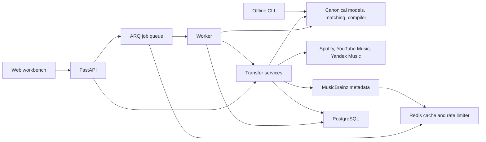

# Architecture

Harmonia separates music identity and playlist policy from service APIs. Canonical models and algorithms run in one Python package; the hosted deployment runs API and worker processes from the same container image.

## Package boundaries

- [`domain/`](src/harmonia/domain/): Pydantic models, metadata normalization, recording matching and playlist optimization. These modules have no network, database or provider SDK dependencies.
- [`application/`](src/harmonia/application/): transfer previews, ordered diffs and export orchestration. Services receive providers and storage objects as arguments.
- [`providers/`](src/harmonia/providers/): the async provider contract, capabilities and adapters. Spotify uses httpx; Yandex Music uses ClientAsync; YouTube Music serializes access to its synchronous SDK session and offloads calls to a thread.
- [`infrastructure/`](src/harmonia/infrastructure/): persistence, configuration, HTTP retries, Redis cache/rate limiting, MusicBrainz and background jobs. `Runtime` constructs and closes these resources.
- [`api/`](src/harmonia/api/) and [`cli.py`](src/harmonia/cli.py): request validation and presentation. The API queues imports, compilation, transfer previews and exports. Offline CLI compilation uses the domain directly.

Add services through the [provider contract](docs/provider-development.md). Provider-specific branches belong in adapters and runtime wiring, not in the matcher or compiler.

## Canonical data

`Artist` represents a musical credit. `Recording` represents a performance or version independently of its release. `Release` describes an album or edition. `Track` combines recording and release metadata with explicit status, genres, provider identifiers and optional `AudioFeatures`. `ProviderTrack` carries a service ID, URL and availability. `Playlist` is an ordered sequence of track occurrences, including duplicates.

Provider IDs remain separate from independent recording IDs. MusicBrainz enrichment can add recording identity without replacing a provider ID. Duration is stored in milliseconds; supplied beat positions use seconds. Features include BPM, key, scale, energy, mood, loudness, beat positions, embedding and fingerprint fields. The compiler uses supported supplied features; Harmonia does not calculate audio features or retrieve streaming audio.

A recording can have multiple version tags, such as live and remaster. Version detection reads labelled descriptors after separators or within brackets, preserving words in ordinary titles such as “Live Forever”. Named remixers, live venues and remaster years remain part of edition identity.

PostgreSQL stores validated JSON snapshots, confirmed mappings, previews and an export journal. Playlist, mapping and operation keys have primary-key constraints. Canonical schema version 1 rejects unknown fields. Import replaces a stored snapshot in a short transaction; it does not keep a transaction open while fetching a remote playlist.

## Matching

Candidates first pass checks for incompatible versions, contradictory recording IDs, implausible artist/title combinations and large known duration differences. Compatible candidates receive priority for exact ISRC or MusicBrainz recording identity, followed by weighted artist/title, duration and album evidence. Fuzzy similarity uses the standard library.

The default automatic threshold is 0.90. A gap below 0.025 between the leading candidates requires review, as do conflicting edition details or known duration differences above five seconds. Results include reasons and alternatives and sort deterministically by confidence and track ID. Confidence is a heuristic score, not a calibrated probability.

Transfer previews collect ISRC results where supported and metadata-search alternatives. MusicBrainz enriches recording identity only when its own match is unambiguous. Missing ISRC metadata is cached as an empty result; ambiguous or unavailable identity evidence produces a review reason. Unavailable destination IDs are excluded.

Confirmed mappings are stored per source track and destination provider. A usable manual mapping takes precedence over searches and is labelled `manual_override`. Confirmation can intentionally select a different edition. Exports require a stored preview with every match resolved.

## Compilation and optimization

Filtering enforces duration availability, explicit policy, version exclusions and requested feature availability. Each beam-search expansion checks recording identity, artist counts and recent artist overlap. Candidate tie-breaking uses a hash of the configured seed and ordered track IDs. Some beam slots retain shorter prefixes so the search can fill duration gaps.

The objective balances duration coverage with tempo, energy and mood curves, seed affinity, harmonic compatibility and adjacent genre diversity. Curves follow elapsed time relative to the requested duration. Two bounded swap passes refine ordering while preserving hard constraints.

The optimizer is a deterministic heuristic and can underfill the requested duration or reach a local optimum. The result includes actual track durations and warnings. Input bounds keep work finite: 1,000 candidates, up to 200 output tracks and beam width 1–32. See [constraints](docs/usage.md#constraints-and-preferences) for public configuration semantics.

## Jobs, writes and concurrency

Long-running API operations return a job ID. ARQ stores queue state and results in Redis; results expire after 24 hours. PostgreSQL stores previews and operation history independently of job result expiry.

Before a remote export, a unique operation key and payload digest are committed to PostgreSQL. Concurrent claims cannot issue duplicate creates for that key. A recorded success can be returned on replay; an unresolved operation blocks replay. External I/O occurs outside the database transaction. Writes and mutation jobs are not automatically retried.

A remote timeout or process crash can occur after a playlist has been created or partly populated. PostgreSQL cannot make the service write transactional; pending or uncertain operations require [operator recovery](docs/operations.md#export-recovery). Spotify import checks its revision before and after pagination. YouTube Music and Yandex Music imports have no equivalent transactional snapshot guarantee.

MusicBrainz requests use an atomic Redis limiter based on Redis server time. Delayed callers recheck eligibility after waking. API and worker share this limiter and metadata cache. Cache keys contain hashes of requests rather than credentials.

## Deployment and access model

The hosted application has one operator API key and one account per configured service. Every `/api` route requires `X-API-Key`; static assets, OpenAPI and `/healthz` are public. The operator key remains in browser memory. Only the theme preference is saved in localStorage.

PostgreSQL does not store provider tokens. Credentials come from server environment variables or read-only files. Compose binds the API to loopback and leaves PostgreSQL/Redis on its private network. Remote access requires TLS and reverse-proxy limits. The application provides no public registration or tenant isolation.

Existing-playlist synchronization, account linking/token refresh, local audio analysis and AI interfaces are outside the current API. Any audio analysis extension must operate on user-provided local files. A text-to-constraints interface must emit validated constraints and leave track selection to the compiler.
